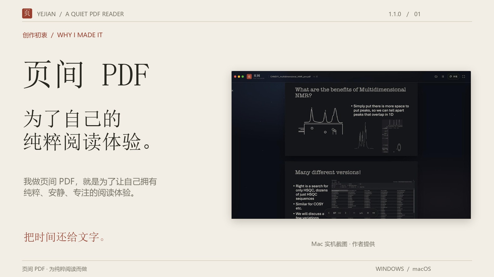
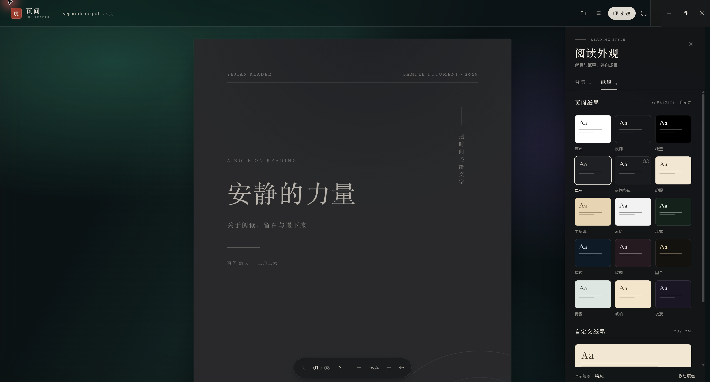
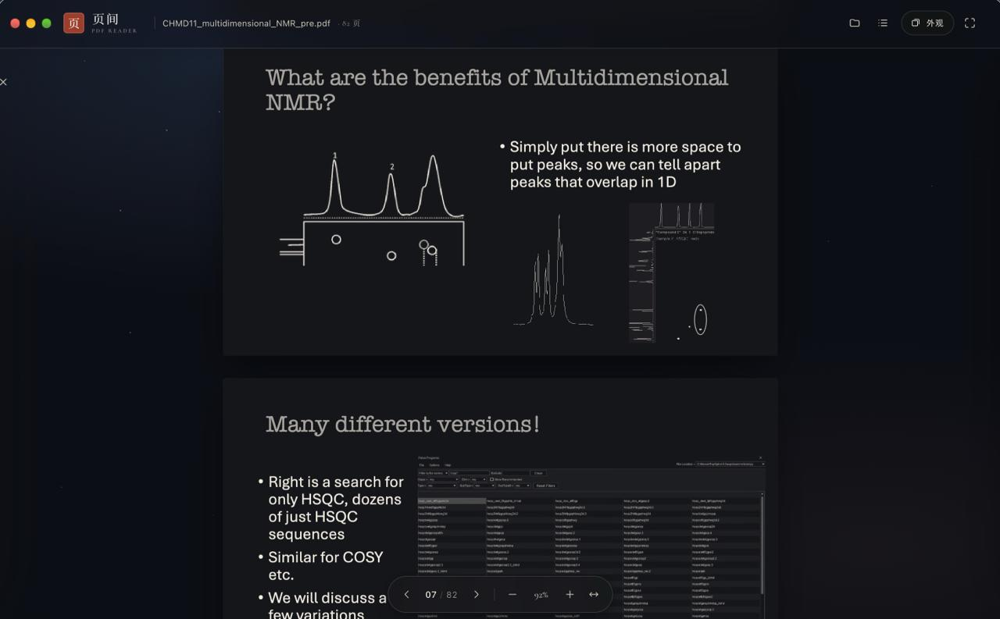
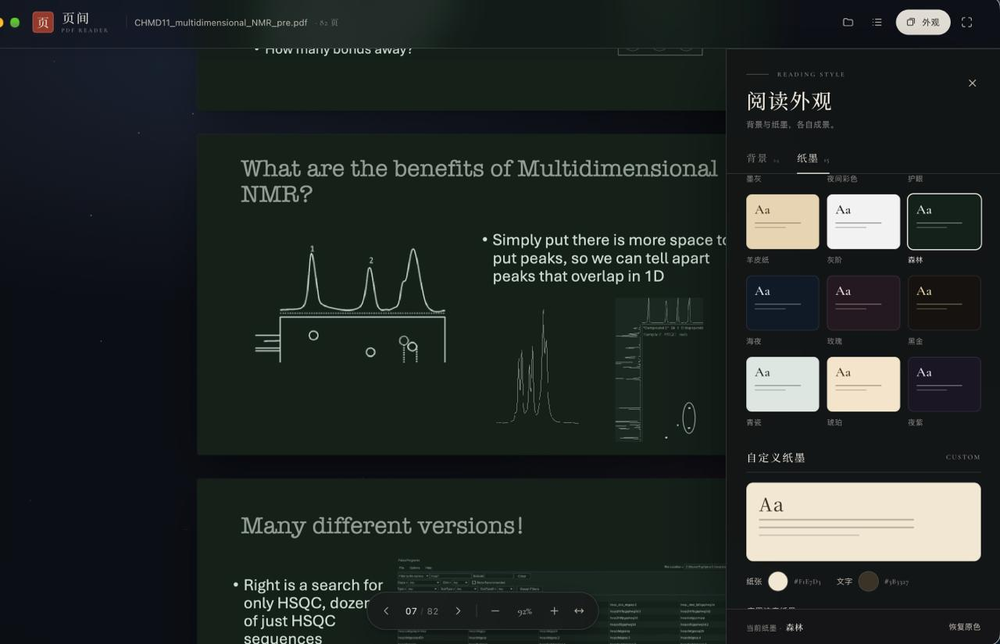

# 页间 PDF

**我做页间 PDF，就是为了让自己拥有纯粹、安静、专注的阅读体验。**

把时间还给文字。页间是一款围绕阅读本身设计的 PDF 阅读器：简约的界面、可独立搭配的背景与纸墨、本地解析，以及顺手的翻页与缩放。

[下载 Windows / Mac 版](https://github.com/FelixJiashengFu/Yejian-PDF/releases/tag/v1.1.0) · [观看产品介绍视频](https://github.com/FelixJiashengFu/Yejian-PDF/releases/download/v1.1.0/Yejian-PDF-1.1.0-introduction-zh-CN.mp4) · [完整功能与使用说明](docs/FEATURES.zh-CN.md)

## 为什么做页间

我做这个软件的出发点很简单：我想要一个属于自己的、纯粹的阅读空间。打开一份 PDF 后，可以舒服地看字、顺畅地翻页，也可以把背景和纸墨调成自己喜欢的样子。

对我来说，阅读体验本身就值得认真对待。页间的每一片底色、每一种纸墨，以及简约安静的界面，都围绕这个初衷展开。

## 它的优势

| 优势 | 具体能做什么 | 对阅读的帮助 |
| --- | --- | --- |
| 简约、安静的阅读空间 | 集中呈现文档、翻页、外观和缩放控制，支持全屏 | 让注意力回到内容 |
| 24 种阅读背景 | 素色、渐变、纹理、氛围四组，可与页面配色独立选择 | 按环境和心情搭配阅读空间 |
| 15 种页面纸墨 | 原色、夜间、纯黑、墨灰、夜间彩色、护眼、羊皮纸、灰阶、森林、海夜、玫瑰、黑金、青瓷、琥珀、夜紫 | 调整整页的明暗与视觉风格 |
| 自定义背景 | 选择本地图片，调节背景暗度和虚化 | 把熟悉的风景带进阅读窗口 |
| 自定义纸墨 | 分别选择纸张颜色与文字颜色 | 找到更符合个人偏好的搭配 |
| 本地解析 | PDF 由设备上的阅读引擎处理，阅读流程不需要上传文件或登录账户 | 本地文档可以直接打开，核心阅读不依赖联网 |
| 连续滚动与快速定位 | 自然向下阅读，左右键翻页，输入页码跳转，缩略图目录定位 | 长文档里更容易回到想看的位置 |
| 灵活缩放 | 50%–250% 缩放、适应宽度、快捷键和 Ctrl/⌘ + 滚轮 | 方便看正文，也方便放大图表 |
| 阅读位置与偏好记忆 | 在本机记住阅读页码、页内位置、外观和缩放偏好 | 再次打开同一份文件时接着读 |
| 桌面体验 | Windows 标题栏随明暗外观调整；Mac 提供对应的原生菜单与窗口处理 | 在不同桌面环境里使用同一套阅读理念 |

纸墨中的“护眼”是预设名称，表示暖色配色；阅读舒适度因人而异。双色调纸墨会连图片一起重新着色，查看需要准确颜色的图表时可选“原色”；“夜间彩色”提供另一种带色彩的深色显示方式，但不保证原始色彩准确。

## 选择你的版本

两个安装包属于**同一款软件的 1.1.0 版本**，分别用于不同系统。

| 平台 | 安装包 | 大小 | 选择建议 |
| --- | --- | --- | --- |
| Windows x64 | [Yejian-PDF-1.1.0-win-x64.exe](https://github.com/FelixJiashengFu/Yejian-PDF/releases/download/v1.1.0/Yejian-PDF-1.1.0-win-x64.exe) | 117.47 MiB | 使用 64 位 Intel / AMD Windows 电脑时选择 |
| macOS Universal | [Yejian-PDF-1.1.0-mac-universal.dmg](https://github.com/FelixJiashengFu/Yejian-PDF/releases/download/v1.1.0/Yejian-PDF-1.1.0-mac-universal.dmg) | 216.72 MiB | Mac 通用安装包；安装前请参阅版本与安装说明 |

Windows 版已在本次发布整理中核对实机界面，Mac 版画面由作者提供。下载和平台要求见[安装说明](docs/INSTALL.zh-CN.md)，文件完整性见 [SHA-256 校验](SHA256SUMS.txt)。

## Windows 版实景

深色阅读、氛围背景和纸墨设置：

## Mac 版实景

深色阅读与氛围背景：

纸墨选择与自定义纸张、文字配色：

## 上手很简单

1. 从 Releases 下载适合自己系统的安装包并安装。
2. 点击“打开 PDF”，或把 PDF 拖入阅读窗口；也可以先打开内置阅读示例。
3. 按 `B` 打开外观面板，分别挑选背景与纸墨。
4. 开始阅读：左右键翻页，`T` 打开页面目录，`F` 切换全屏，`+` / `-` 缩放，`0` 恢复适应宽度。

更多细节见[完整介绍](docs/FEATURES.zh-CN.md)，包括全部背景、全部纸墨、自定义方式、快捷键和适用边界。

## 产品视频

视频使用作者提供的一张 Windows 与两张 Mac 版实机截图，配合中文动效字幕，讲述创作初衷、阅读外观、本地解析、导航缩放、记忆功能和双平台下载。时长 2 分 23 秒，采用安静的无声呈现；Windows 截图使用软件内置示例，Mac 截图展示作者提供的阅读画面。[视频文字稿](docs/VIDEO-SCRIPT.zh-CN.md) · [字幕文件](media/Yejian-PDF-1.1.0-introduction-zh-CN.srt)

## 关于本仓库

本仓库用于分发安装包、产品介绍、实机截图和介绍视频。软件源码未在本次发布中提供。公开下载不等同于授予开源许可；软件权利归原权利人所有，第三方组件遵循各自许可。
